  <picture>
    <source media="(prefers-color-scheme: dark)" srcset="assets/banner-dark.v9.svg">
    <source media="(prefers-color-scheme: light)" srcset="assets/banner-light.v9.svg">
    
  </picture>

   

  <!-- Animated Introduction -->
  

  
Computer Science Graduate · Fergusson College, Pune

  

    
    
    
    
    
  

---
 
## 💻 This Is Me :)
 
<table>
  <tr>
    <td width="60%" valign="middle">
      <ul>
        <li>🎓 Computer Science graduate from Fergusson College, Pune.</li>
        <li>📊 Interested in data analytics, statistics, and data-driven decision-making.</li>
        <li>🐍 Working with Python, Pandas, NumPy, SQL, and Scikit-learn.</li>
        <li>🐍 Working with Python, Pandas, NumPy, SQL, Power BI, and Scikit-learn.</li>
        <li>🧩 Building end-to-end data analysis and machine learning projects.</li>
        <li>🗄️ Practicing SQL joins, CTEs, window functions, and analytical queries.</li>
        <li>🤖 Learning model evaluation, deployment, and experiment tracking.</li>
        <li>📈 Improving data visualization and analytical storytelling.</li>
        <li>💼 Open to entry-level Data Analyst, Associate Data Scientist, and Junior ML Engineer roles.</li>
        <li>📍 Hyderabad, India</li>
        <li>📫 <a href="mailto:girheritesh1@gmail.com">Email me</a></li>
      </ul>
    </td>
    <td width="40%" align="center" valign="middle">
      
    </td>
  </tr>
</table>

---

## 🧰 Tech Stack 

<table>
  <tr>
    <th width="22%" align="left">Category</th>
    <th align="left">Tools &amp; Skills</th>
  </tr>
  <tr>
    <td><b>💻 Languages</b></td>
    <td>
      
      
      
      
    </td>
  </tr>
  <tr>
    <td><b>📊 Analysis &amp; Visualization</b></td>
    <td>
      
      
      
      
      
      
    </td>
  </tr>
  <tr>
    <td><b>📐 Statistics &amp; Math</b></td>
    <td>
      
      
      
      
    </td>
  </tr>
  <tr>
    <td><b>🤖 Machine Learning</b></td>
    <td>
      
      
      
      
      
    </td>
  </tr>
  <tr>
    <td><b>🗄️ Databases</b></td>
    <td>
      
      
      
    </td>
  </tr>
  <tr>
    <td><b>⚙️ Backend &amp; Deployment</b></td>
    <td>
      
      
      
      
      
    </td>
  </tr>
  <tr>
    <td><b>🔧 Dev Tools</b></td>
    <td>
      
      
      
      
      
    </td>
  </tr>
</table>

---

## 🚀 Featured Projects 

<table>
  <tr>
    <th width="50%" align="left">🌱 AgriSense AI</th>
    <th width="50%" align="left">🛡️ Fraud Detection System</th>
  </tr>
  <tr>
    <td valign="top">
      
<b>Smart Agriculture · Machine Learning · Full-Stack App</b>

      

        An ML-powered agricultural decision-support application with five prediction workflows for crop, fertilizer, irrigation, price, and yield.
      

      
<b>Key Features</b>

      <ul>
        <li>Five model-backed prediction workflows</li>
        <li>Live weather integration</li>
        <li>FastAPI backend and React frontend</li>
      </ul>
      
<b>Tech Stack</b>

      

        
        
        
        
      

      
    </td>
    <td valign="top">
      
<b>Classification · Imbalanced Data · ML Deployment</b>

      

        An end-to-end fraud detection project using the PaySim financial transaction dataset to identify potentially fraudulent transactions.
      

      
<b>Key Features</b>

      <ul>
        <li>Data validation and exploratory analysis</li>
        <li>Imbalanced classification and model evaluation</li>
        <li>Planned workflow for MLflow tracking and deployment</li>
      </ul>
      
<b>Tech Stack</b>

      

        
        
        
        
      

      <!-- Replace the URL below with your actual fraud detection repository -->
      
    </td>
  </tr>
</table>

---

 
## 🏆 Certifications & Learning

<table>
  <tr>
    <th align="left">Course</th>
    <th align="left">Provider</th>
    <th align="left">Focus</th>
    <th align="center">Certificate</th>
  </tr>

  <tr>
    <td>🐍 <b>Python Data Analysis</b></td>
    <td>freeCodeCamp</td>
    <td>Data Analysis with Python Developer Certification</td>
    <td align="center">
      
    </td>
  </tr>

  <tr>
    <td>🐼 <b>Pandas</b></td>
    <td>Kaggle Learn</td>
    <td>Data manipulation and analysis with Pandas</td>
    <td align="center">
      
    </td>
  </tr>

  <tr>
    <td>📊 <b>Data Visualization</b></td>
    <td>Kaggle Learn</td>
    <td>Data visualization techniques and charting</td>
    <td align="center">
      
    </td>
  </tr>

  <tr>
    <td>🤖 <b>Intro to Machine Learning</b></td>
    <td>Kaggle Learn</td>
    <td>Building and validating introductory ML models</td>
    <td align="center">
      
    </td>
  </tr>

  <tr>
    <td>🧠 <b>Intermediate Machine Learning</b></td>
    <td>Kaggle Learn</td>
    <td>Model improvement, missing values, categorical variables, and pipelines</td>
    <td align="center">
      
    </td>
  </tr>
</table>

---
 
## 📈 GitHub Analytics :)
 

<!-- Streak and views -->

   
 
<!-- Profile details -->

 
<!-- Language bar -->

  
 

---

## 🌐 Connect with Me :)

  
  
  
  

---

  <i>"Data is more than numbers; it's the foundation of better decisions."</i> 
  <b>— Ritesh Girhe</b>

  

 
